<p align="center">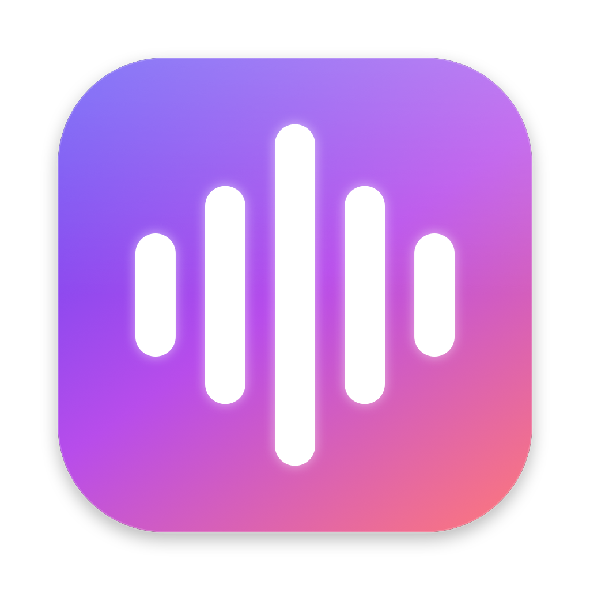</p>
<h1 align="center">Murmur</h1>
<p align="center"><b>Hold a key, speak, let go: polished text appears wherever your cursor is.</b><br>
Native macOS dictation with on-device or OpenRouter models, custom vocabulary and an LLM polish pass.</p>
<p align="center">
  <a href="https://github.com/jmaddington/murmur/releases/latest"><b>Download</b></a> ·
  <a href="https://jmaddington.github.io/murmur/">Website</a> ·
  <a href="https://jmaddington.github.io/murmur/media/demo.mp4">Demo video (with sound)</a>
</p>

<p align="center">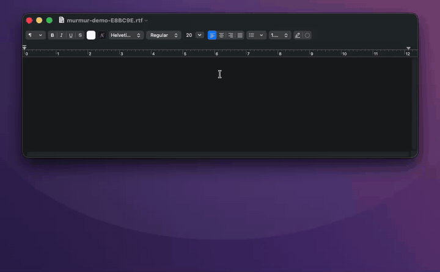</p>
<p align="center"><sub>Recorded from the real app by its own demo mode (<code>Murmur --e2e --demo</code>): on-device transcription, vocabulary correction, then Claude Haiku cleanup turning "um, Tuesday, no wait, Wednesday" into one clean sentence.</sub></p>

<table>
<tr>
<td>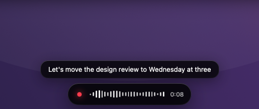</td>
<td>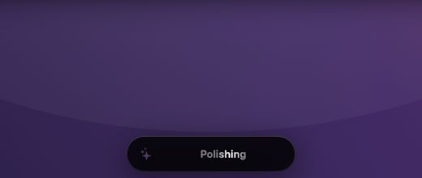</td>
<td>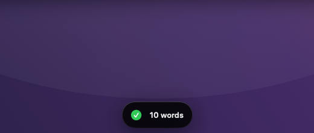</td>
</tr>
<tr><td align="center"><sub>Live preview</sub></td><td align="center"><sub>Polishing</sub></td><td align="center"><sub>Typed for you</sub></td></tr>
</table>

<table>
<tr>
<td>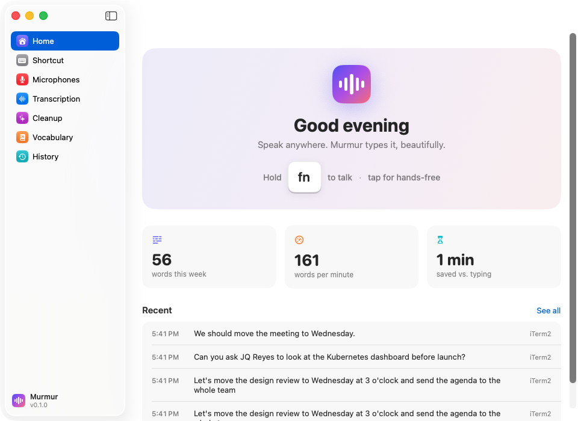</td>
<td>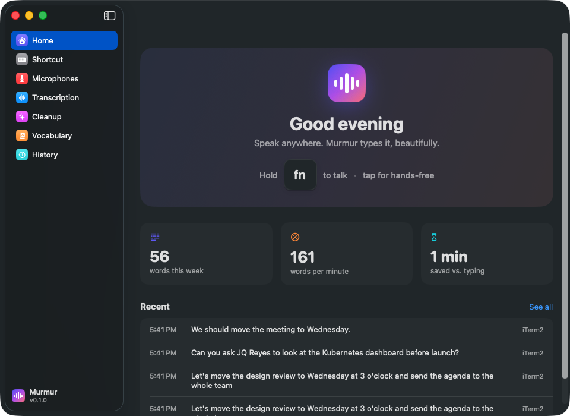</td>
</tr>
<tr>
<td>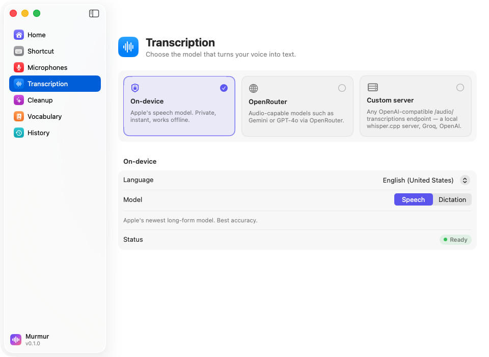</td>
<td>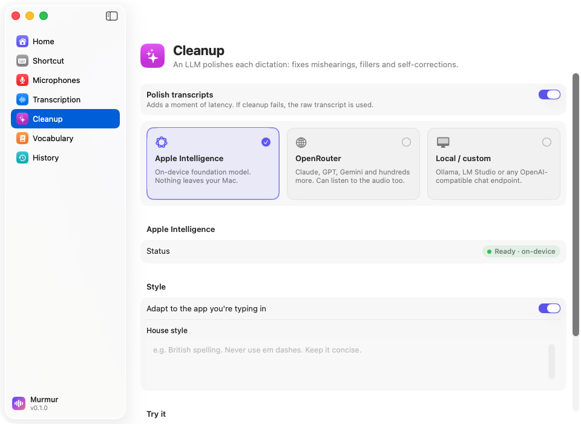</td>
</tr>
<tr>
<td>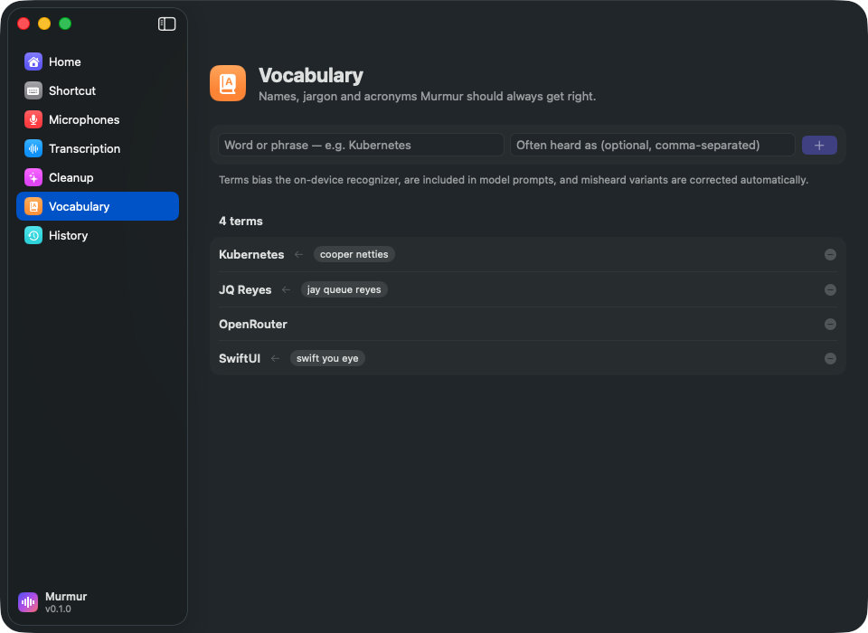</td>
<td>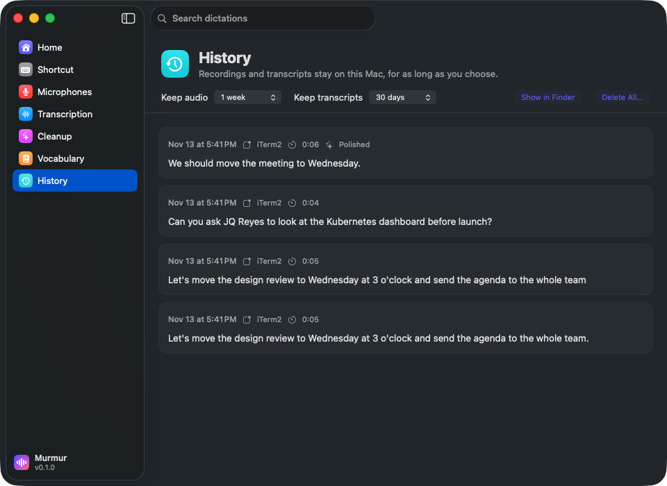</td>
</tr>
</table>

## Overview

A dictation app for macOS 26+ on Apple silicon.

- **Swift / SwiftUI / AppKit** — native UI, menu bar app, floating HUD, global hotkeys, audio capture, Apple's on-device `SpeechAnalyzer` and Foundation Models.
- **Rust core** (`core/`) — vocabulary correction, prompt construction, WAV encoding, OpenRouter + OpenAI-compatible HTTP, on-disk history and retention. Linked as a static library behind a 3-function C ABI (`core/include/murmur_core.h`).

## Install

Download the signed, notarized **DMG** (drag to Applications) or **PKG** (Installer / MDM) from [Releases](https://github.com/jmaddington/murmur/releases/latest).

## Build & run

```sh
brew install rust            # once
./scripts/build.sh           # → build/Murmur.app
open build/Murmur.app        # or: cp -R build/Murmur.app /Applications/
```

Grant **Microphone** and **Accessibility** on first run (Home pane has buttons). Without Accessibility, Murmur copies the text and tells you to ⌘V.

> Local builds are ad-hoc signed unless a Developer ID cert is in your keychain, so macOS may ask for Accessibility again after each rebuild.

## Features

| | |
|---|---|
| Trigger | Hold fn / right ⌥ / right ⌘ / right ⌃, or record any custom shortcut (e.g. ⌃⌥D, F13). Hold = push-to-talk, quick tap = hands-free, esc = cancel. |
| Microphones | Priority list (drag to reorder, toggle off). The first connected mic wins. If a mic fails to open, or opens but sends no audio within 0.6s (virtual/remote devices, sleeping Bluetooth), Murmur fails over to the next one mid-dictation, then to the system default. |
| Transcription | On-device (Apple Speech or Dictation model, live preview), OpenRouter audio models, or any OpenAI-compatible `/audio/transcriptions` server (whisper.cpp, Groq, OpenAI). |
| Cleanup | Optional LLM pass: Apple Intelligence (on-device), OpenRouter (optionally *with the audio*), or local Ollama / LM Studio. Fillers, self-corrections, mishearings, app-aware tone, custom house style. Falls back to the raw transcript on failure. |
| Vocabulary | Terms + "often heard as" variants. Biases the on-device recognizer, goes into every prompt, and a deterministic Rust pass fixes misheard variants (punctuation-insensitive + fuzzy). |
| History | Audio (m4a) and transcripts kept for separately chosen periods (don't keep … forever). Play, copy, re-transcribe, delete. Stored in `~/Library/Application Support/Murmur/History`. |
| Secrets | API keys live in the Keychain. |

## Tests

```sh
(cd core && cargo test)                     # Rust unit tests
./tests/e2e/run.sh                          # full end-to-end suite
OPENROUTER_API_KEY=sk-or-… ./tests/e2e/run.sh   # + live OpenRouter cases
```

The e2e harness (`Murmur --e2e`) runs synthesized speech through the real pipeline (HUD → analyzer → vocabulary → cleanup → insertion → history), talks to a mock OpenRouter/OpenAI server that validates the wire format, smoke-tests the real microphone if permitted, and captures screenshots of every pane and HUD state in light and dark mode. Output: `build/e2e/report.json`, `build/e2e/screenshots/`. Settings, Keychain items and history are isolated from your real ones.

Real screenshots need Screen Recording for your terminal; otherwise the harness renders windows in-process.

`Murmur --e2e --demo --out build/demo` records the product demo used above: it hides other apps, lays a backdrop over the desktop, dictates scripted audio into TextEdit through the real pipeline while `screencapture -v` records, and writes `demo.mov`, `timeline.json` (for mixing the voice back in with ffmpeg) and HUD stills.

## Releases, signing & installers

```sh
brew install create-dmg
VERSION=1.0.0 ./scripts/build.sh && ./scripts/package.sh
```

`build/dist/` gets:

| File | For |
|---|---|
| `Murmur-<v>.dmg` | Branded drag-to-Applications installer |
| `Murmur-<v>.pkg` | Installer.app / MDM deployment (Addigy, Jamf, Kandji…). Installs to /Applications and relaunches Murmur for the logged-in user. |
| `Murmur-PPPC.mobileconfig` | MDM profile that pre-approves Accessibility, pinned to the app's signing requirement. Microphone can't be pre-approved by MDM. |
| `SHA256SUMS.txt` | Checksums |

Signing and notarization happen automatically when credentials are present:

- **Developer ID Application** cert in the keychain (or `MURMUR_SIGN_IDENTITY`): signs the app and DMG, with hardened runtime and a secure timestamp.
- **Developer ID Installer** cert (or `MURMUR_INSTALLER_IDENTITY`): signs the PKG.
- **App Store Connect API key** (`NOTARY_KEY_PATH`, `NOTARY_KEY_ID`, `NOTARY_ISSUER`): notarizes and staples both.

Without them you get ad-hoc / unsigned artifacts, which are fine for local testing.

### GitHub Actions

- **CI** (`.github/workflows/ci.yml`): every push and PR runs Rust tests, the e2e suite and an unsigned packaging smoke test. The report and screenshots are uploaded as an artifact. Cases that need Apple Intelligence or Accessibility skip themselves on hosted runners.
- **Release** (`.github/workflows/release.yml`): pushing a `v*` tag (or a manual run) imports certificates into a temporary keychain, tests, builds, signs, packages, notarizes, and attaches everything to a GitHub Release.

Repository secrets for releases, all scoped to a `release` environment:

| Secret | What |
|---|---|
| `DEVELOPER_ID_APP_P12` / `DEVELOPER_ID_APP_PASSWORD` | `base64 -i DeveloperIDApplication.p12` and its password |
| `DEVELOPER_ID_INSTALLER_P12` / `DEVELOPER_ID_INSTALLER_PASSWORD` | Same for the installer cert |
| `ASC_API_KEY_P8` | Contents of `AuthKey_XXXX.p8` (App Store Connect › Users and Access › Integrations › Team Keys, role *Developer*) |
| `ASC_API_KEY_ID` / `ASC_API_ISSUER_ID` | From the same page |
| `OPENROUTER_E2E_KEY` | *(optional, CI)* runs the live OpenRouter e2e cases |

## Layout

```
core/                 Rust core (staticlib)
Sources/CMurmurCore/  module map for the C header
Sources/Murmur/
  App.swift           menu bar app, prewarming
  Core/               settings, keychain, hotkeys, history, insertion, dictation state machine
  Audio/              CoreAudio device priority, AVAudioEngine capture
  Engines/            SpeechAnalyzer / remote transcription, cleanup
  UI/                 HUD, settings window and panes
  E2E.swift           test harness
scripts/              build.sh, package.sh, icon + installer art, PPPC profile, ci/
tests/e2e/            cases, mock server, audio fixtures
```
